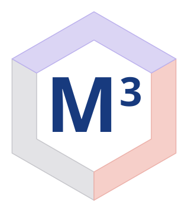
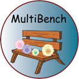

<!-- ━━━━━━━━ MAIN ━━━━━━━━ -->
<main style="max-width:1120px; margin:0 auto; padding:0 28px;">

<!-- HERO — asymmetric split (text + meta on the left, sphere on the right) -->
<section class="dc-hero-split" style="display:grid; grid-template-columns:1fr 1.05fr; gap:52px; align-items:center; padding:58px 0 48px;">

Single&#8209;cell method ecosystem

<h1 style="font-family:'Newsreader','Charter',Georgia,serif; font-size:54px; line-height:1.03; font-weight:600; letter-spacing:-0.022em; margin:0 0 22px; color:var(--text); max-width:13ch; text-wrap:balance;">Multi&#8209;Task Omics</h1>

An ecosystem of methods for multimodal, multibatch multi&#8209;condition single&#8209;cell analysis.

$ pip install m3&#8209;sc multibench&#8209;sc matilda&#8209;sc

<a class="dc-metalink" href="https://github.com/PYangLab/MultiTaskOmics" style="display:inline-flex; align-items:center; gap:6px; font-size:13px; font-weight:500; color:var(--text-muted); text-decoration:none;"><svg width="15" height="15" viewBox="0 0 24 24" fill="currentColor" aria-hidden="true"><path d="M12 2C6.48 2 2 6.58 2 12.25c0 4.53 2.87 8.37 6.84 9.73.5.1.68-.22.68-.49 0-.24-.01-.88-.01-1.73-2.78.62-3.37-1.37-3.37-1.37-.45-1.18-1.11-1.49-1.11-1.49-.91-.64.07-.62.07-.62 1 .07 1.53 1.06 1.53 1.06.89 1.57 2.34 1.12 2.91.85.09-.66.35-1.12.63-1.38-2.22-.26-4.55-1.14-4.55-5.06 0-1.12.39-2.03 1.03-2.75-.1-.26-.45-1.3.1-2.71 0 0 .84-.27 2.75 1.05a9.32 9.32 0 0 1 5 0c1.91-1.32 2.75-1.05 2.75-1.05.55 1.41.2 2.45.1 2.71.64.72 1.03 1.63 1.03 2.75 0 3.93-2.34 4.79-4.57 5.05.36.32.68.94.68 1.9 0 1.37-.01 2.48-.01 2.82 0 .27.18.6.69.49A10.02 10.02 0 0 0 22 12.25C22 6.58 17.52 2 12 2Z"></path></svg>GitHub</a>

<a class="dc-metalink" href="#references" style="font-size:13px; font-weight:500; color:var(--text-muted); text-decoration:none;">Read the papers ↗</a>

3 packages · 11 tasks

<canvas id="taskSphere" aria-label="A slowly rotating globe: a shared Omics core connected to single-cell tasks across M3, scMultiBench and Matilda, with related tasks linked on the surface. Drag to spin; hover a task to highlight its connections." style="display:block; width:100%; height:520px; cursor:grab; touch-action:none;"></canvas>

</section>

<!-- PACKAGES -->
<section style="padding:6px 0 0;">

Packages

<a class="dc-pkg" href="https://pyanglab.github.io/M3/" style="display:grid; grid-template-columns:auto 1fr; align-items:center; gap:20px; padding:18px 22px; border:1px solid var(--border); border-radius:14px; background:var(--bg-card); text-decoration:none; color:var(--text);">

M3
Factorised, condition&#8209;aware embeddings — multimodal integration with patient&#8209;level inference.
IntegrationPatient predictionAttribution

</a>

<a class="dc-pkg" href="https://dsichang.github.io/scMultiBench/" style="display:grid; grid-template-columns:auto 1fr; align-items:center; gap:20px; padding:18px 22px; border:1px solid var(--border); border-radius:14px; background:var(--bg-card); text-decoration:none; color:var(--text);">

scMultiBench
Run &amp; score 40+ integration methods with scIB metrics — rankings, bubble tables, an interactive explorer.
IntegrationBatch correctionBenchmarking

</a>

<a class="dc-pkg" href="https://pyanglab.github.io/Matilda/" style="display:grid; grid-template-columns:auto 1fr; align-items:center; gap:20px; padding:18px 22px; border:1px solid var(--border); border-radius:14px; background:var(--bg-card); text-decoration:none; color:var(--text);">

Matilda
One network for many tasks — trained once, reused across the analysis pipeline.
ClassificationDimension reductionFeature selectionSimulation

</a>

</section>

<!-- REFERENCES -->
<section id="references" style="padding:48px 0 0; scroll-margin-top:90px;">

References

Condition-aware deep factor learning with M3 enables integration, patient-level inference, and multi-resolution interpretation in multimodal single-cell data
Chunlei Liu, Sichang Ding, Shila Ghazanfar, Pengyi Yang

<a class="dc-ref" href="https://www.nature.com/articles/s41592-025-02856-3" target="_blank" rel="noopener noreferrer" style="display:block; padding:14px 16px; border-radius:10px; text-decoration:none; color:var(--text);">

Multitask benchmarking of single-cell multimodal omics integration methods
Chunlei Liu, Sichang Ding, Hani Jieun Kim, Siqu Long, Di Xiao, Shila Ghazanfar, Pengyi Yang
<em>Nature Methods</em> · 22, 2449–2460 (2025)

</a>

<a class="dc-ref" href="https://academic.oup.com/nar/article/51/8/e45/7076464" target="_blank" rel="noopener noreferrer" style="display:block; padding:14px 16px; border-radius:10px; text-decoration:none; color:var(--text);">

Multi-task learning from multimodal single-cell omics with Matilda
Chunlei Liu, Hao Huang, Pengyi Yang
<em>Nucleic Acids Research</em> · 51(8), e45 (2023)

</a>

</section>
</main>

<!-- ━━━━━━━━ BAND ━━━━━━━━ -->
<section style="margin-top:56px; padding:26px 0 28px; background:var(--bg-elevated); border-top:1px solid var(--border); border-bottom:1px solid var(--border);">

Independent packages — <strong style="color:var(--text); font-weight:500;">install only what you need</strong>.
<a href="methods/" style="font-size:13.5px; font-weight:500; color:var(--brand-600); text-decoration:none;">Which tool do I need? →</a>

</section>

